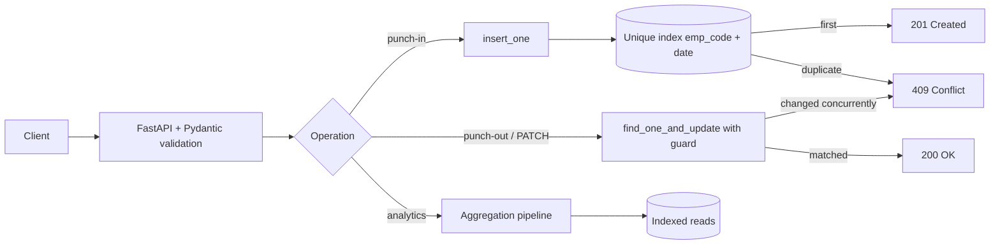

<div align="center">

# Employee Attendance & Analytics API

**A production-style attendance backend: punch in/out with business rules, audited corrections, and analytics powered by MongoDB aggregation pipelines.**

<br />


<br /><br />


<br /><br />

[Quick start](#-quick-start) ·
[API](#-api-reference) ·
[Business rules](#-business-rules) ·
[Design](#-design-highlights) ·
[Testing](#-testing--verification) ·
[Troubleshooting](#-troubleshooting)

</div>

---

## Overview

Built for the **HROne Software Engineer Trainee** technical assignment. The service lets employees punch in and out, lets HR correct records with a full audit trail, and answers business questions (who is late, which department is slipping, what does the trend look like) directly in the database.

| | |
|---|---|
| **Status** | All endpoints in the contract are implemented |
| **Code layout** | Single file: [`app/main.py`](app/main.py) |
| **Self-check** | 52 automated checks passed against a real MongoDB |
| **Scale test** | 100,000 attendance records, every endpoint under 1 second |

## Technology stack

| Technology | Role |
|---|---|
|  **Python 3.11+** | Language |
|  **FastAPI** | HTTP API, validation, OpenAPI docs |
|  **MongoDB 6.0+** | Storage, aggregation pipelines, window functions |
| **PyMongo** | Database driver (timezone-aware datetimes) |
| **Pydantic v2** | Strict request validation |
| **Uvicorn** | ASGI server |
|  **Docker** *(optional)* | Local MongoDB |

## Quick start

> Prerequisites: **Python 3.11+**, **Git**, and **MongoDB 6.0+** (local Docker container or a free Atlas cluster).

### Step 1: Get the code

```bash
git clone https://github.com/vinaybabannavar-create/hrone-employee-attendance-api.git
cd hrone-employee-attendance-api
```

### Step 2: Start MongoDB

Pick one:

```bash
# Option A: Docker
docker run -d --name mongo -p 27017:27017 mongo:7
```

Option B: create a free cluster on MongoDB Atlas and copy its connection string.

### Step 3: Create a virtual environment and install dependencies

**Windows (PowerShell)**

```powershell
python -m venv .venv
.\.venv\Scripts\Activate.ps1
pip install -r requirements.txt
```

**macOS / Linux**

```bash
python3 -m venv .venv
source .venv/bin/activate
pip install -r requirements.txt
```

### Step 4: Configure the environment

The app reads two environment variables. Real environment variables always take priority over a local `.env` file.

| Variable | Example | Meaning |
|---|---|---|
| `MONGO_URI` | `mongodb://localhost:27017` | MongoDB connection string |
| `MONGO_DB` | `attendance_db` | Database name |

**Windows (PowerShell)**

```powershell
$env:MONGO_URI = "mongodb://localhost:27017"
$env:MONGO_DB  = "attendance_db"
```

**macOS / Linux**

```bash
export MONGO_URI="mongodb://localhost:27017"
export MONGO_DB="attendance_db"
```

### Step 5: Run the API

```bash
uvicorn app.main:app --port 8000
```

All indexes are created automatically at startup (idempotent). No manual database steps.

### Step 6: Try it

| Resource | URL |
|---|---|
| Interactive docs (Swagger UI) | http://localhost:8000/docs |
| Health check | http://localhost:8000/health |

Suggested first walkthrough in Swagger UI:

1. `POST /employees` to create `EMP0001`.
2. `POST /attendance/punch-in` for `EMP0001`.
3. `POST /attendance/punch-out` for `EMP0001`.
4. `GET /attendance?emp_code=EMP0001` to see the computed `late_minutes`, `work_hours`, `overtime_minutes`, `half_day`.
5. `PATCH /attendance/EMP0001/{date}` to correct the record, then read `history`.

## API reference

| Method | Endpoint | Purpose |
|---|---|---|
| `GET` | `/health` | 200 only when MongoDB answers, otherwise 503 |
| `POST` | `/employees` | Create an employee (409 on duplicate `emp_code`) |
| `GET` | `/employees` | List, filter by department, paginated, sorted by `emp_code` |
| `POST` | `/attendance/punch-in` | Create the day's record (race-safe) |
| `POST` | `/attendance/punch-out` | Close the record; works across midnight |
| `GET` | `/attendance` | Filter by employee / dates / status, paginated |
| `PATCH` | `/attendance/{emp_code}/{date}` | Regularize a record and append to `history` |
| `GET` | `/analytics/employees/{emp_code}/monthly` | Monthly summary for one employee |
| `GET` | `/analytics/departments/summary` | Department summary for a month |
| `GET` | `/analytics/leaderboard/late` | Late-comers ranking with ties |
| `GET` | `/analytics/departments/{department}/trend` | Daily series with 7-day moving average |
| `GET` | `/admin/explain/{endpoint}` | MongoDB `executionStats` for an endpoint's main query |

Conventions: employees are identified by `emp_code` (never `_id`); every instant is **epoch milliseconds**; dates are `YYYY-MM-DD` (IST); months are `YYYY-MM`. Errors use FastAPI's `{"detail": ...}` body.

## Business rules

| Rule | Behaviour |
|---|---|
| **R1** Dates & time zone | Attendance dates are IST. On an overnight shift (`shift_end <= shift_start`), a punch-in earlier than `shift_end` belongs to the previous day's shift. Instants are truncated to whole seconds. |
| **R2** Late | Late only if strictly more than 10:00 after `shift_start`; then `late_minutes` is the floor of minutes since `shift_start`. (09:40:00 → 0, 09:40:01 → 10, 10:15:59 → 45) |
| **R3** Overtime | Floor minutes from `shift_end` to punch-out, counted only if at least 30. |
| **R4** Work hours | Seconds / 3600, rounded to 2 decimals **half-up** (exact `Decimal` arithmetic). |
| **R5** Half day | Rounded `work_hours` < 4.50. Counts as 0.5 of a present day. |
| **R6–R7** Presence & working days | `PRESENT`, `WFH`, `ON_DUTY` count as present. Working days are Mon–Fri, counted from `joined_on`. |
| **R8** Rounding | Reported numbers: 2 decimals half-up; rates: 4 decimals half-up. |
| **R9** Headcount | Everyone who joined on or before the period end, with or without logs. |
| **R10** Pagination | `page` from 1, `page_size` max 100, `total` reflects filters. |

## Design highlights



- **Concurrency is decided by the database.** Parallel identical punch-ins produce exactly one `201`; the unique `(emp_code, date)` index rejects the rest with `409`. Punch-out and PATCH use atomic compare-and-set updates, so concurrent corrections never lose history.
- **Analytics run inside MongoDB.** Monthly summary uses `$group`; department summary starts from `employees` and uses `$lookup` so employees with no logs still count; the leaderboard uses `$setWindowFields` with `$rank` (competition ranking, `limit` applied after ranking); the trend fills missing days with `$range` and `$unionWith` and computes the moving average with a document window.
- **Stored derived values are authoritative.** `late_minutes`, `work_hours`, `overtime_minutes`, and `half_day` are written by the API; analytics read them and never recompute.
- **Correct rounding.** Half-up everywhere via `Decimal`, because both Python's `round()` and MongoDB's `$round` round half to even.
- **Defensive reads.** Legacy documents missing `history` or `half_day` are treated as empty and `false`. Responses never expose `_id`.
- **Timezone-safe.** The Mongo client is timezone-aware, so naive and aware datetimes can never be mixed.
- **Indexes at startup.** Created idempotently, covering list, monthly, month-wide analytics, status filter, and the punch-out lookup. The explain endpoint builds each query with the same code as the real endpoint.

## Performance

Measured locally on **100,000 attendance records** (1,000 employees × 100 days):

| Endpoint | Time |
|---|---|
| `GET /attendance?page=1` | 0.25 s |
| `GET /attendance` (employee + date range) | 0.03 s |
| Employee monthly | 0.05 s |
| Department summary | 0.85 s |
| Late leaderboard | 0.15 s |
| Department trend (91 days) | 0.21 s |

`/admin/explain/*` shows an `IXSCAN` and no `COLLSCAN` for all five endpoints.

## Testing & verification

Two optional helper scripts live in `scripts/` (not part of the application):

```bash
# Functional self-check: seeds awkward data into a throw-away database, compares analytics
# with an independent pure-Python implementation, checks rules, status codes, concurrency, explain.
python scripts/verify_local.py

# Scale check: seeds 100k records for manual timing (see the instructions printed by the script).
python scripts/load_check.py
```

`verify_local.py` uses its own database (`attendance_verify`) and removes it afterwards. For `load_check.py`, start the app only **after** the script prints that it has seeded the data, otherwise the indexes the app created are wiped.

## Project structure

```text
hrone-employee-attendance-api/
├── app/
│   ├── __init__.py
│   └── main.py            # all application code
├── scripts/
│   ├── verify_local.py    # optional functional self-check
│   └── load_check.py      # optional 100k-record scale check
├── DECISIONS.md           # design decisions (indexes, races, ties, headcount, scaling)
├── REVIEW.md              # review of the starter code
├── requirements.txt
└── README.md
```

## Assumptions

- `moving_avg_7d` averages the **unrounded** daily rates and rounds once at the end (R8).
- A PATCH that changes none of `status`, `punch_in`, `punch_out` is a `422`, even if stored derived values would differ.
- Concurrent PATCH requests on one record use an optimistic guard; the loser receives `409`.
- A request to punch in on a date that already has a seeded `ABSENT` / `LEAVE` record returns `409`.

## Troubleshooting

| Symptom | Fix |
|---|---|
| `running scripts is disabled` when activating the venv | `Set-ExecutionPolicy -Scope Process Bypass` then activate again |
| `No module named uvicorn` | Activate the venv, then `pip install -r requirements.txt` |
| `Unable to create process` for `uvicorn.exe` | Use `python -m uvicorn app.main:app --port 8000` |
| `port is already allocated` (Docker) or `only one usage of each socket address` (Uvicorn) | Something already uses the port: stop the old process (Ctrl+C) or reuse it |
| `/health` returns 503 | MongoDB is not reachable: check `MONGO_URI` and that MongoDB is running |
| Queries feel slow after re-seeding | Restart the app so it rebuilds indexes |

## Documentation

- [`DECISIONS.md`](DECISIONS.md): five short design decisions
- [`REVIEW.md`](REVIEW.md): review of the starter code and the fixes

---

<div align="center">

**Vinay Babannavar** · Final-year Computer Science Engineering student

<a href="https://github.com/vinaybabannavar-create">
  
</a>

</div>
